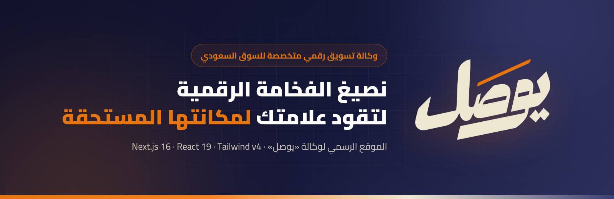
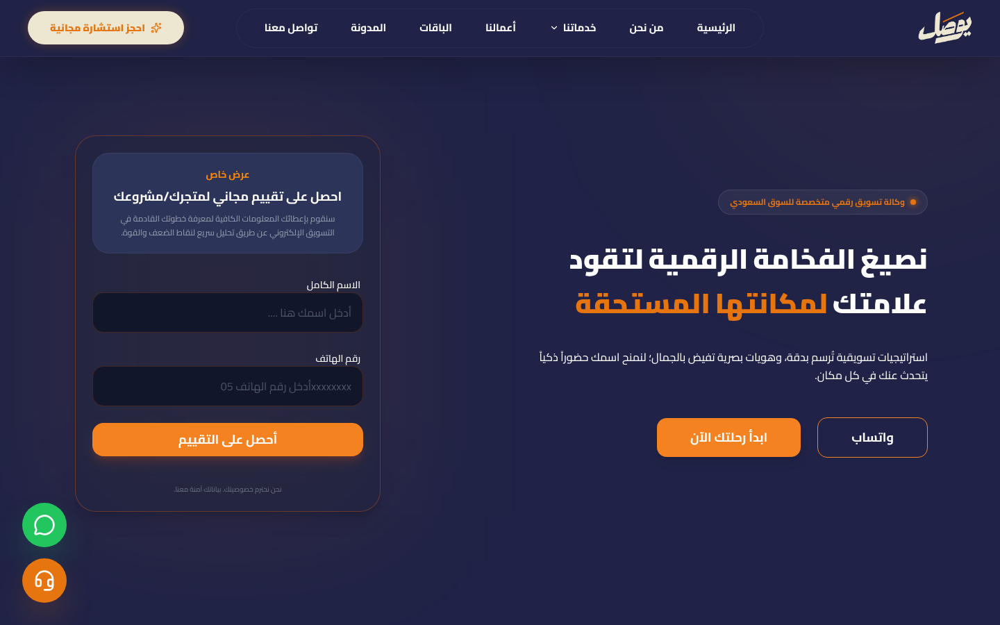
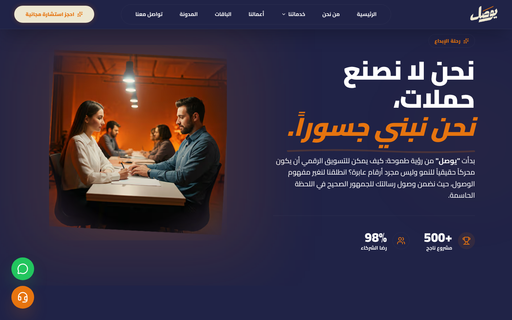
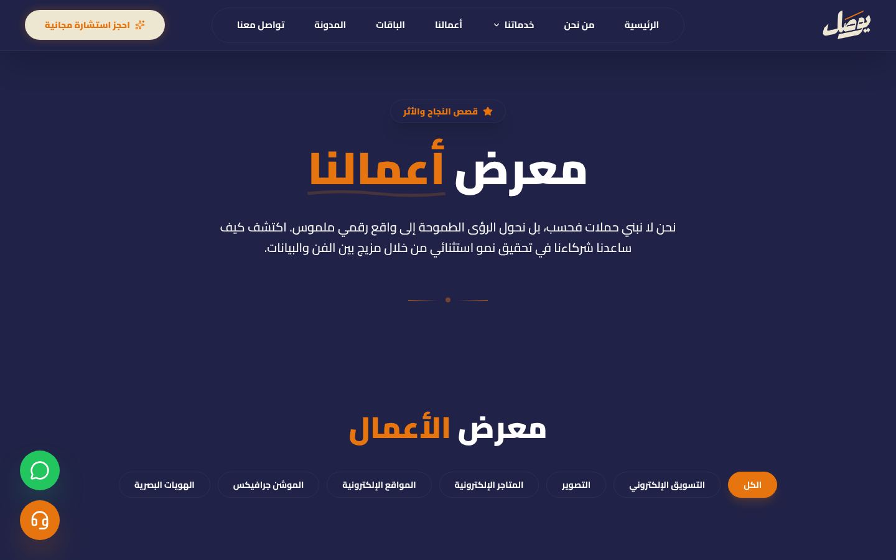
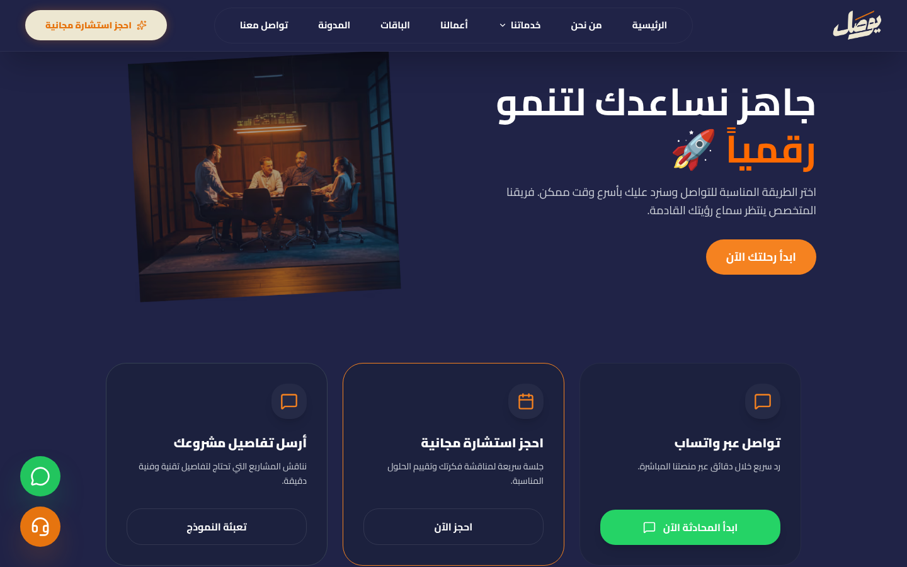
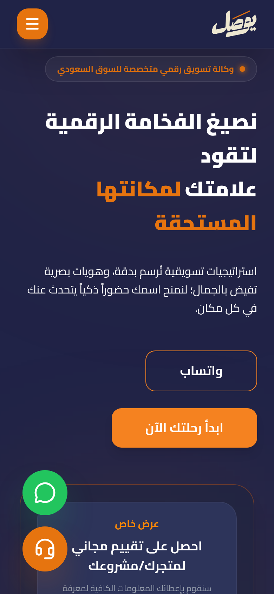
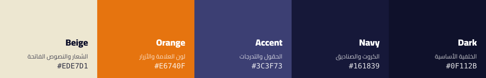
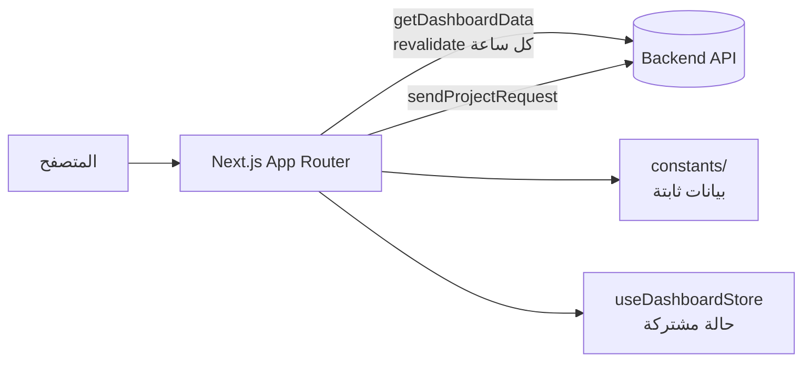

<div align="center">



<br />


**موقع وكالة «يوصل» للتسويق والخدمات الرقمية**
واجهة عربية بالكامل (RTL) تعرض الخدمات والباقات والأعمال والمدونة، مع نموذج تواصل وطلب مشروع مرتبط بالـ Backend.

*Arabic-first (RTL) marketing site for the "Yosal" digital agency, built with the Next.js App Router.*

[المميزات](#-المميزات) •
[لقطات الشاشة](#-لقطات-الشاشة) •
[التقنيات](#-التقنيات) •
[التشغيل](#-التشغيل-السريع) •
[هيكل المشروع](#-هيكل-المشروع) •
[المساهمة](#-آلية-المساهمة)

</div>

<br />

## ✨ المميزات

<div dir="rtl">

| | الميزة | الوصف |
| :-: | :-- | :-- |
| 🌐 | **واجهة عربية RTL** | تصميم كامل من اليمين لليسار بخط Cairo، متجاوب مع الجوال والتابلت والديسكتوب. |
| 🛠️ | **صفحات الخدمات** | صفحة لكل خدمة (`/services/[slug]`) بمخرجات وخطوات عمل وأسئلة شائعة. |
| 💼 | **معرض الأعمال** | مشاريع قابلة للتصفية حسب التصنيف، وصفحة تفصيلية لكل مشروع. |
| 📦 | **الباقات** | عرض الباقات والأسعار مباشرة من الـ Backend. |
| 📝 | **المدونة** | مقالات مع صفحة تفصيلية لكل مقال (`/blog/[slug]`). |
| 📨 | **طلب مشروع وتواصل** | نماذج تواصل وتقييم مجاني ترسل البيانات إلى الـ Backend، مع إشعارات فورية. |
| 💬 | **تواصل سريع** | أزرار واتساب ودعم عائمة في كل الصفحات. |
| 🎞️ | **حركة متوازنة** | ظهور تدريجي عند التمرير، انتقالات بين الصفحات وتفاعلات دقيقة عبر framer-motion. |
| 🔍 | **SEO** | `sitemap.xml` و`robots.txt` تلقائيان وصفحات خطأ مخصّصة (404 / error). |

</div>

## 🖼️ لقطات الشاشة

<div align="center">



**الصفحة الرئيسية**

<br />

<table>
  <tr>
    <td align="center" width="50%">
      
      <br /><b>من نحن</b>
    </td>
    <td align="center" width="50%">
      
      <br /><b>معرض الأعمال</b>
    </td>
  </tr>
  <tr>
    <td align="center" width="50%">
      
      <br /><b>تواصل معنا</b>
    </td>
    <td align="center" width="50%">
      
      <br /><b>نسخة الجوال</b>
    </td>
  </tr>
</table>

</div>

## 🎨 هوية البراند

الألوان معرّفة في `tailwind.config.ts` و`app/globals.css`، والشعار في `public/assets/logo.png`.



<div dir="rtl">

| الاسم | القيمة | الاستخدام |
| :-- | :-: | :-- |
| 🟦 **Dark** | `#0F112B` | الخلفية الأساسية العميقة |
| 🟦 **Navy** | `#161839` | الكروت والصناديق |
| 🟪 **Accent** | `#3C3F73` | الحقول والتدرجات |
| 🟧 **Orange** | `#E6740F` | لون العلامة والأزرار والتمييز |
| 🟨 **Beige** | `#EDE7D1` | الشعار والنصوص الفاتحة |

الخط: **Cairo** (عبر `next/font`).

</div>

## 🧰 التقنيات

<div align="center">

[](https://nextjs.org)
[](https://react.dev)
[](https://www.typescriptlang.org)
[](https://tailwindcss.com)
[](https://www.framer.com/motion/)
[](https://ui.shadcn.com)
[](https://eslint.org)

</div>

<div dir="rtl">

- **Next.js 16** (App Router) + **React 19** + **TypeScript**
- **Tailwind CSS v4** (`@tailwindcss/postcss`) + `tw-animate-css`
- **framer-motion** للحركة
- **shadcn / Radix UI / class-variance-authority** للمكوّنات
- **lucide-react** و**react-icons** للأيقونات
- **react-hot-toast** للإشعارات

</div>

> [!WARNING]
> هذه النسخة من Next.js فيها تغييرات جذرية. راجع `AGENTS.md` والأدلة في `node_modules/next/dist/docs/` قبل كتابة الكود.

## 🚀 التشغيل السريع

المتطلبات: **Node.js 20.9** أو أحدث (يُنصح بـ 22 LTS) و**npm**.

```bash
npm ci                      # تثبيت الاعتماديات
cp .env.example .env.local  # إعداد متغيرات البيئة
npm run dev                 # تطوير: http://localhost:3000
```

| الأمر | الوظيفة |
| :-- | :-- |
| `npm run dev` | تشغيل نسخة التطوير |
| `npm run lint` | فحص ESLint |
| `npm run build` | بناء نسخة الإنتاج |
| `npm run start` | تشغيل نسخة الإنتاج (بعد `build`) |

### 🔐 متغيرات البيئة

انظر `.env.example`. ملفات `.env*` الحقيقية مُتجاهَلة في git.

| المتغير | الوصف |
| :-- | :-- |
| `NEXT_PUBLIC_API_URL` | عنوان الـ Backend API. القيمة الافتراضية في `lib/api.ts` هي سيرفر الإنتاج. |
| `NEXT_PUBLIC_SITE_URL` | الرابط العام للموقع. |

## 🗂️ هيكل المشروع

```text
yosal-company/
├── app/                  المسارات (about, blog/[slug], contact, packages,
│                         portfolio/[slug], private, services/[slug], terms) + layout.tsx
├── components/
│   ├── layout/           Navbar, Footer, ChatSystem
│   ├── sections/         أقسام الصفحات (home, about, blog, packages, ...)
│   ├── form/             ContactForm, DataForm, ReadyForm, SubscriptionForm
│   └── ui/               AppButton, AppCard
├── constants/            بيانات ثابتة (blogData, servicesData, siteData, teamData)
├── hooks/                useDashboardStore (حالة البيانات)
├── lib/                  api.ts (استدعاءات الـ Backend), utils.ts
├── types/                تعريفات TypeScript
├── public/               الصور والملفات الثابتة (assets/logo.png ...)
└── docs/                 صور وقوالب الـ README
```

## 🔄 تدفّق البيانات



- **الـ Backend:** `lib/api.ts` يقرأ `NEXT_PUBLIC_API_URL` ويوفّر `getDashboardData()` (جلب بيانات لوحة الموقع مع `revalidate` كل ساعة) و`sendProjectRequest()` (إرسال طلب مشروع من نماذج التواصل). عند فشل الطلب تُرجَع `null` ويُسجَّل الخطأ.
- **البيانات الثابتة:** مجلد `constants/` يحوي محتوى لا يأتي من الـ API (مقالات المدونة التجريبية، آراء العملاء، الفريق، بيانات الموقع) ويُستورد مباشرة في المكوّنات.
- **الحالة:** `hooks/useDashboardStore.ts` يشارك بيانات الـ Backend بين المكوّنات.

## 🤝 آلية المساهمة

1. **ميزة واحدة = فرع واحد = Pull Request واحد**، يُفرَّع من أحدث `main` بأسماء واضحة (`feat/...`, `fix/...`, `chore/...`, `docs/...`).
2. رسائل commit بصيغة **Conventional Commits** (`feat:`, `fix:`, `docs:`, `chore:` ...).
3. تُنسب الـ commits إلى اسم صاحب المستودع، ولا تُضاف أسطر نسب لأدوات الذكاء الاصطناعي (مثل `Co-Authored-By`).
4. قبل فتح الـ PR شغّل `npm run lint` و`npm run build`، واستخدم قالب الـ PR (What / Why / How verified / Checklist) وأرفق لقطات شاشة لتغييرات الواجهة.
5. الـ CI (`.github/workflows/ci.yml`) يشغّل lint وbuild على كل PR وعلى كل push إلى `main`.

<br />

<div align="center">

**يوصل** — نصيغ الفخامة الرقمية لتقود علامتك لمكانتها المستحقة

</div>
